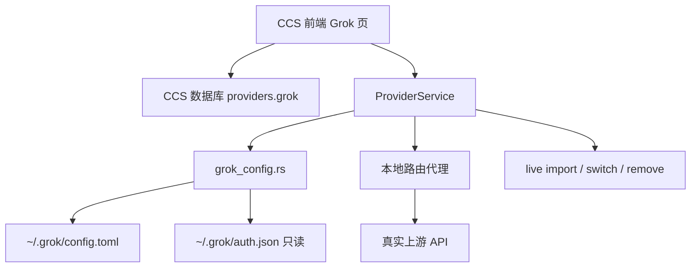

# Grok Build 完整应用接入设计

> 状态：已通过口头设计确认，待用户审阅本规格后进入实现计划  
> 日期：2026-07-12  
> 源码基线：`/home/scv/cc-switch-build` @ `main`（`3.16.5` / `f39d463c`）  
> 目标：在 CC Switch 中新增 `Grok` 应用类型，支持供应商管理，并在高级选项中对齐 Codex 的本地路由、思考能力、思考等级、模型映射与上下文设置

---

## 1. 背景与目标

### 1.1 背景

本机已安装 Grok Build CLI：

- 命令：`grok`（`/home/scv/.local/bin/grok` → `~/.grok/bin/grok`）
- 版本示例：`0.2.94`
- 主配置：`~/.grok/config.toml`
- 登录态：`~/.grok/auth.json`（xAI OAuth）
- 当前默认模型：`[models].default = "grok-build"`

CC Switch 目前支持：

- Claude / Claude Desktop / Codex / Gemini / OpenCode / OpenClaw / Hermes

尚未支持 Grok。

### 1.2 目标

第一期将 Grok 作为完整应用接入 CC Switch，做到：

1. 新增 `Grok` 应用页与应用类型
2. 管理官方 xAI 与第三方供应商
3. 安全读写 `~/.grok/config.toml`
4. 支持从 live 配置导入已有自定义 model
5. 在供应商高级选项中支持：
   - 本地路由映射
   - 思考能力
   - 支持思考等级
   - 模型映射
   - 上下文设置
6. 检测本机 `grok` 安装与版本
7. 支持配置目录覆盖 `grokConfigDir`

### 1.3 非目标（第一期明确不做）

- Grok MCP 全量同步
- Grok Skills 同步
- 会话管理深度接入
- 自动浏览器 `grok login` 流程（只提示用户自行登录）
- 完整复刻 Codex 全部整流策略
- 自动替换系统菜单中的正式安装包（发布步骤另做）

---

## 2. 总体方案

### 2.1 选型结论

采用 **Hermes 风格完整应用接入 + Codex 风格高级选项**：

- 应用模式参考 Hermes / OpenCode：累加式供应商（additive）
- 高级能力参考 Codex：本地路由、思考能力、思考等级、模型映射、上下文

### 2.2 架构

```text
CCS 前端 Grok 页
  -> ProviderService / AppState
    -> grok_config.rs  (读写 ~/.grok/config.toml，识别 auth.json)
    -> 本地路由代理     (仅 useLocalRoute=true 的第三方供应商)
    -> SQLite providers.grok
```



### 2.3 两种运行模式

| 模式 | 适用 | 行为 |
|---|---|---|
| 直连模式 | 官方 xAI；原生兼容第三方 | 直接写 `~/.grok/config.toml` 的 `[model.*]` 与 `[models].default` |
| 本地路由模式 | 需要模型映射 / 思考转换的第三方 | Grok 指向 CCS 本地路由；真实上游、映射、思考参数由代理处理 |

规则：

- 官方 xAI **禁止**开启本地路由
- 第三方默认建议开启本地路由（可手动关闭，关闭后仅直连写配置）
- 思考能力 / 思考等级在本地路由模式下保证生效；直连模式仅尽量透传

---

## 3. 配置与数据模型

### 3.1 文件系统

| 路径 | 作用 | CCS 权限 |
|---|---|---|
| `~/.grok/config.toml` | 默认模型、自定义 model、UI 等 | 读写（带备份） |
| `~/.grok/auth.json` | 官方 OAuth 登录态 | 只读识别 |
| `~/.grok/bin/grok` 或 PATH 中的 `grok` | CLI 本体 | 只读检测版本 |
| `~/.cc-switch/backups/grok/` | 配置备份 | 写入 |

配置目录可通过设置项 `grokConfigDir` 覆盖，解析优先级：

1. CCS 设置 `grokConfigDir`
2. 默认 `~/.grok`

### 3.2 TOML 安全写入策略

新增 `src-tauri/src/grok_config.rs`，职责：

1. 读取全量 `config.toml`
2. 只修改：
   - `[models].default`
   - 由 CCS 管理的 `[model.<id>]`
3. 不修改用户其他段：`[ui]`、`[cli]`、`[marketplace]`、`[auth]`、hooks 等
4. 写前备份
5. 原子写入（临时文件 + rename）
6. 进程内写锁，避免并发踩踏
7. 解析/写入失败时保留原文件并返回明确错误

备份策略与现有 Hermes/OpenClaw 一致，使用有效备份保留数量设置。

### 3.3 应用类型

在后端 `AppType` 与前端应用列表中新增：

- 枚举：`AppType::Grok`
- 字符串 ID：`grok`
- 显示名：`Grok`
- `is_additive_mode() = true`

需同步更新所有 `AppType` 穷尽匹配点，至少包括：

- `app_config.rs`
- provider service / live import
- settings 目录覆盖
- 前端 `App.tsx` 应用切换
- i18n
- misc 工具检测（安装/版本）

### 3.4 供应商 settingsConfig

```ts
// appType = "grok"
interface GrokProviderSettingsConfig {
  kind: "official" | "custom";

  // 直连 / 原生字段（写入 [model.<id>] 或作为路由元数据）
  model: string; // 上游真实 model，或官方模型 id
  base_url?: string;
  api_key?: string;
  env_key?: string;
  api_backend?: "chat_completions" | "responses" | "messages";
  name?: string;
  description?: string;
  context_window?: number;
  temperature?: number;
  top_p?: number;
  max_completion_tokens?: number;
  extra_headers?: Record<string, string>;

  // 高级：本地路由
  useLocalRoute?: boolean;

  // 高级：模型映射表
  modelMappings?: Array<{
    id: string; // Grok / 路由侧模型名
    upstreamModel: string; // 真实上游模型名
    displayName?: string;
    contextWindow?: number;
    isDefault?: boolean;
  }>;

  // 高级：思考能力（语义对齐 Codex）
  grokChatReasoning?: {
    supportsThinking?: boolean;
    supportsEffort?: boolean;
    thinkingParam?: "thinking" | "enable_thinking" | "reasoning_split";
    effortParam?: "reasoning_effort" | "reasoning.effort" | "none";
    effortValueMode?: "openai" | "openrouter";
  };

  // 可选默认思考等级
  defaultReasoningEffort?: "low" | "medium" | "high" | "xhigh" | "max";
}
```

约定：

- CCS `provider.id` 作为稳定主键
- 官方供应商建议：`id = "xai-official"`，默认模型 `grok-build`
- 第三方直连时，`[model.<segment>]` 的段名使用稳定、可序列化的 id（小写、连字符）
- `settingsConfig.model` 始终表示“上游真实模型名”或官方模型名
- 本地路由开启时，写入 Grok 的 `base_url` 指向 CCS 本地路由，而不是真实上游

### 3.5 官方供应商规则

预置 `xAI Official`：

- `kind = "official"`
- 默认模型：`grok-build`
- 不强制写 `api_key`
- 切换时设置 `[models].default` 为官方模型
- 不覆盖 `auth.json`
- 页面展示登录态：
  - 已登录：脱敏显示 email / 是否过期
  - 未登录：提示执行 `grok login`
- 禁止 `useLocalRoute = true`

### 3.6 live 同步规则

| 动作 | 行为 |
|---|---|
| 首次打开 Grok 页 / 显式刷新 | 扫描 `config.toml` 的 `[model.*]`，导入到 CCS |
| 添加/编辑供应商 | 写 DB；按模式 upsert live 配置 |
| 切换当前供应商 | 更新 DB current；写 `[models].default`；若本地路由则确保 takeover |
| 删除供应商 | 删 DB；custom 删除对应 live model 段；官方不删除 Grok 内建模型 |
| 外部手改 config | 下次导入时以 live 为准更新可同步字段 |

导入时跳过明显由本地路由托管生成的临时段（若存在 CCS 标记字段），避免重复污染。

默认策略：

- **优先不向 TOML 写未知托管标记字段**
- 用 CCS DB + provider id 约定追踪托管关系
- 实现前先验证 Grok 对未知键的容忍度；若安全再考虑标记字段

---

## 4. 高级选项设计（对齐 Codex）

### 4.1 本地路由映射

字段：`useLocalRoute`

开启后：

1. 确保 CCS 本地路由服务可用
2. 将 Grok 当前入口 `base_url` 指到本地路由 Grok/OpenAI-compatible 端点
3. 真实上游 `base_url` / `api_key` / `api_backend` 保存在供应商元数据
4. 代理负责模型映射与思考参数转换

关闭后：

1. 取消该应用/供应商的 takeover（若无其他依赖）
2. 将真实上游信息写回 Grok 直连配置

官方供应商始终不可开启。

### 4.2 思考能力 / 思考等级

字段：`grokChatReasoning`

| 开关 | 含义 |
|---|---|
| `supportsThinking` | 上游支持开启/关闭 thinking |
| `supportsEffort` | 上游支持 low/high/max 等思考深度 |

联动：

- 打开 `supportsEffort` 时，自动打开 `supportsThinking`
- 关闭 `supportsThinking` 时，自动关闭 `supportsEffort`
- 默认参数可复用 Codex 习惯：
  - `thinkingParam = "thinking"`
  - `effortParam = "reasoning_effort"`

生效位置：

- 本地路由模式：代理转换请求体，保证生效
- 直连模式：若 Grok 原生支持对应字段则透传；否则仅保存元数据，不伪造能力

### 4.3 模型映射 + 上下文设置

字段：`modelMappings[]`

表格列：

- 显示名
- Grok/路由模型 ID
- 上游模型名
- 上下文窗口
- 是否默认

规则：

- 至少 1 条映射
- 若无显式默认，取第一行
- 切换供应商时：
  - `[models].default` 设为默认映射的 `id`（本地路由）或对应 model 段
  - 对应 `context_window` 写入 Grok 可识别位置
- 上下文为空时使用 Grok 默认，但 UI 允许用户显式填写

第一期推荐映射落地方式：

- **一个供应商一个默认入口 model**
- 映射表主要给本地路由在请求期做 `requestedModel -> upstreamModel`
- 同时把默认条目的 `contextWindow` 同步到入口 model 配置

---

## 5. 前端设计

### 5.1 应用入口

- `App.tsx` 应用列表新增 `grok`
- 可见性跟随现有 `visibleApps` 机制
- 设置页可开关显示

### 5.2 页面结构

Grok 页包含：

1. 状态条
   - CLI 安装状态与版本
   - 官方登录态
   - 当前默认模型
2. 供应商列表
   - 当前供应商高亮
   - 切换 / 编辑 / 删除
3. 添加/编辑对话框

### 5.3 表单布局

**基础区**

- 预设选择
- 名称
- Base URL（官方只读/隐藏）
- API Key（官方可空）
- API Backend
- 默认模型

**高级区（折叠）**

- 本地路由开关
- 思考能力
- 支持思考等级
- 模型映射表
- 上下文窗口

高级区若已有值，默认展开（对齐 Codex 行为）。

### 5.4 设置页

新增：

- `grokConfigDir`
- 描述：覆盖 Grok 配置目录（`config.toml` / `auth.json`）

### 5.5 i18n

至少补充 `zh` / `zh-TW` / `en` / `ja`：

- 应用名
- 表单标签与提示
- 本地路由风险提示
- 未安装 / 未登录提示
- 校验错误文案

---

## 6. 后端模块划分

### 6.1 新增

- `src-tauri/src/grok_config.rs`
  - 路径解析
  - TOML 读/写
  - provider upsert/remove
  - apply switch defaults
  - auth 状态只读解析
  - 备份
- `src/config/grokProviderPresets.ts`
- `src/components/providers/forms/GrokFormFields.tsx`
- `src/components/providers/forms/hooks/useGrokFormState.ts`
- 必要 API / query hooks

### 6.2 修改（代表性）

- `app_config.rs`：AppType / 默认 apps
- `services/provider/mod.rs`、`live.rs`：switch/import/remove
- `settings.rs` + 前端 settings 类型：目录覆盖
- `commands/misc.rs`：检测安装与版本
- `App.tsx` / `ProviderForm.tsx` / `ProviderList.tsx` 等 UI 分发
- i18n 文件

### 6.3 本地路由接入点

优先复用现有 proxy / takeover 基础设施，而不是新建独立代理栈。

需要明确 Grok 在 takeover 中的 app key：

- app id：`grok`
- 写入 live 的本地地址格式与现有 OpenAI-compatible 端点保持一致
- 请求转换最小集：
  - model rewrite
  - thinking/effort injection
  - Authorization / 自定义 headers

第一期不要求实现 Codex 全部 thinking 整流分支，只要求：

1. 能按映射改模型
2. 能按开关注入 thinking/effort
3. 失败时返回可诊断错误

---

## 7. 错误处理

| 场景 | 处理 |
|---|---|
| 未安装 `grok` | 页面仍可用；提示安装；允许先写配置 |
| 官方未登录 | 可切换官方；提示 `grok login` |
| `config.toml` 损坏 | 拒绝覆盖；报错；保留原文件与最近备份 |
| 写配置失败 | 恢复备份；toast 明确错误 |
| 官方开启本地路由 | 前端禁用 + 后端拒绝 |
| 模型映射为空 | 保存拦截 |
| 删除当前供应商 | 自动回退官方或第一个可用 |
| 并发写入 | 写锁 + 原子写 |
| 本地路由未启动 | 切换时尝试启动/提示失败原因 |

敏感信息：

- `api_key`、token 不写日志
- auth 展示仅脱敏 email / 过期状态

---

## 8. 测试计划

### 8.1 后端单测

- 路径解析与 `grokConfigDir` 覆盖
- TOML 只改目标段，不破坏 `[ui]` / marketplace
- upsert / remove provider
- switch 设置 `models.default`
- 官方禁止本地路由
- 备份创建与失败回滚
- auth.json 只读解析（过期/未登录/已登录）

### 8.2 前端单测

- 表单校验：URL、映射表、思考开关联动
- 官方/第三方字段显隐
- 高级区有值自动展开
- 预设填充

### 8.3 手工验收

1. 最新源码可 `pnpm dev` / `pnpm tauri dev` 启动
2. 应用切换可见 Grok
3. 官方切换到 `grok-build` 成功
4. 添加第三方直连供应商并设默认成功
5. 开启本地路由 + 思考等级 + 模型映射后，元数据保存正确
6. `config.toml` 中用户原有 UI 配置不被破坏
7. 删除非当前 / 当前供应商行为符合预期

---

## 9. 完成定义（DoD）

- [ ] 新增 `AppType::Grok` 与前端 Grok 页
- [ ] 可添加/编辑/切换/删除 Grok 供应商
- [ ] 可安全写回 `~/.grok/config.toml` 并带备份
- [ ] 官方直连可用，且识别登录态
- [ ] 第三方直连可用
- [ ] 高级选项具备：本地路由、思考能力、思考等级、模型映射、上下文
- [ ] 本地路由模式下模型映射与思考参数可生效
- [ ] 基础自动测试通过
- [ ] 关键验收清单通过
- [ ] 未把 MCP / Skills / 会话深度接入塞进第一期

---

## 10. 实现分期建议

### Phase 1：骨架

- AppType / 设置目录 / 页面入口 / 官方预设
- `grok_config` 基础读写与备份

### Phase 2：供应商闭环

- 添加/编辑/切换/删除
- live import
- 官方与第三方直连

### Phase 3：高级选项

- 模型映射与上下文
- 思考能力 / 思考等级元数据
- 本地路由接管与最小转换

### Phase 4：打磨

- i18n
- 测试补齐
- 手工验收与文档

---

## 11. 风险与缓解

| 风险 | 影响 | 缓解 |
|---|---|---|
| Grok TOML 未知字段不兼容 | 写坏配置或启动警告 | 先不写托管标记字段；保留备份；最小字段集 |
| 本地路由与 Grok 协议不完全匹配 | 高级能力失效 | 第一期限定 OpenAI-compatible；失败可回退直连 |
| AppType 穷尽匹配遗漏 | 编译失败或运行分支漏处理 | 以编译器穷尽匹配 + 全仓搜索 hermes 触点为清单 |
| 用户已有复杂 config | 覆盖用户设置 | 只改目标键；导入而非重写整文件 |
| 官方 OAuth 过期 | 切换后仍不可用 | 状态条提示重新登录，不伪造成功 |

---

## 12. 已确认决策摘要

1. 先同步线上最新 CCS，再二开：已完成，基线 `3.16.5`
2. 接入方式：方案 A 完整应用接入
3. 第一期包含 Codex 对齐高级选项：
   - 本地路由映射
   - 思考能力
   - 支持思考等级
   - 模型映射
   - 上下文设置
4. 不做 MCP / Skills / 会话深度接入
5. 官方走直连 + OAuth 识别；第三方可直连或本地路由

---

## 13. 下一步

规格审阅通过后：

1. 使用 `writing-plans` 产出实现计划
2. 按 Phase 1 → 4 实施
3. 每阶段做最小可验证验收
